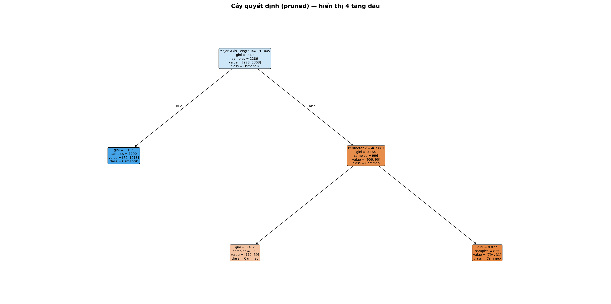
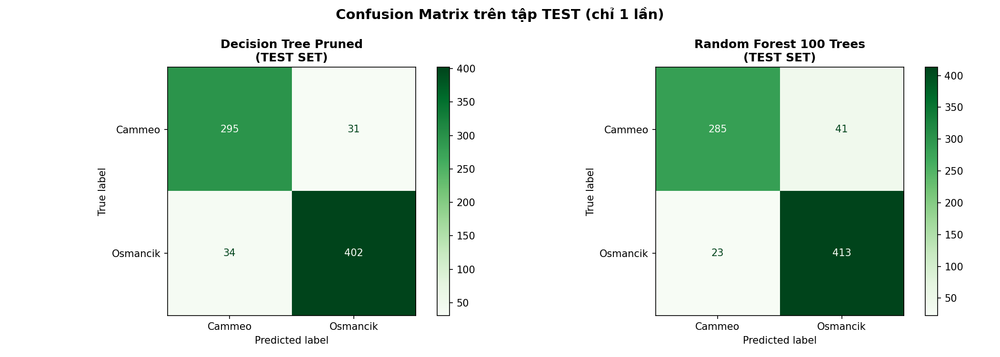
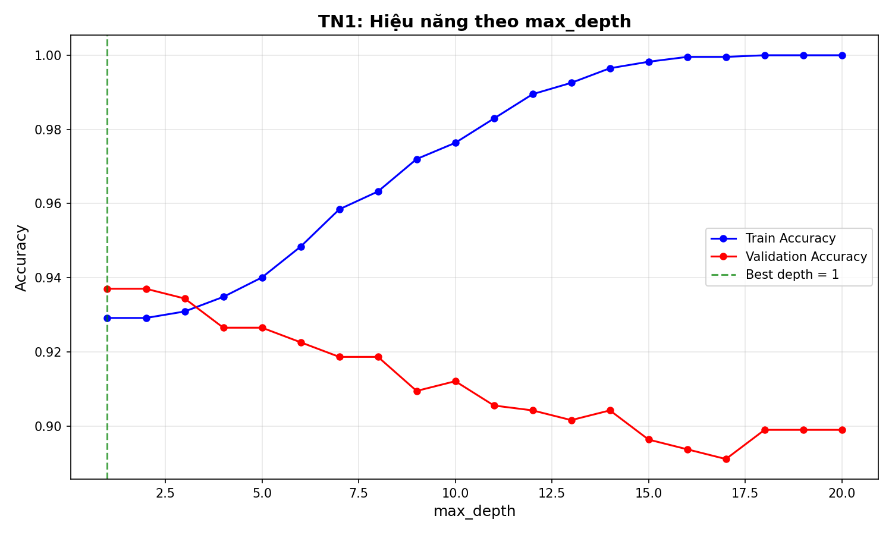
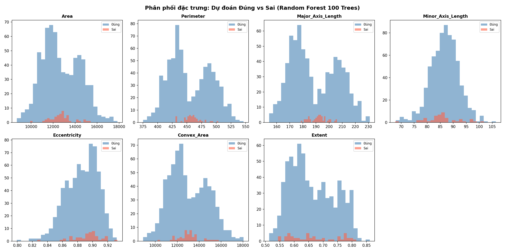

# 🌾 Rice Variety Classification: Cammeo vs. Osmancik
### Dự Án Học Máy Cơ Bản — Project 17: Phân Loại Hai Giống Gạo Từ Hình Dạng Hạt

[](https://www.python.org/)
[](https://scikit-learn.org/)
[](https://flask.palletsprojects.com/)
[](https://creativecommons.org/licenses/by/4.0/)
[]()
[]()

> **Câu hỏi nghiên cứu trọng tâm:**  
> *"Liệu một mô hình Cây quyết định tối giản (đã cắt tỉa ccp_alpha) có đủ chính xác và dễ giải thích, hay bắt buộc phải đánh đổi bằng Rừng ngẫu nhiên phức tạp?"*

---

## 📌 1. Tổng Quan Dự Án

* **Lĩnh vực:** Học máy & Thị giác máy tính (Machine Learning & Computer Vision)
* **Phương pháp áp dụng:** Cây quyết định (Decision Tree), Cắt tỉa (Cost-Complexity Pruning) và Rừng ngẫu nhiên (Random Forest).
* **Dữ liệu thực nghiệm:** [Rice (Cammeo and Osmancik) Dataset - UCI Machine Learning Repository](https://archive.ics.uci.edu/dataset/545/rice+cammeo+and+osmancik) (3,810 mẫu hạt gạo, 7 đặc trưng hình học, CC BY 4.0).

---

## 📊 2. Kết Quả Thực Nghiệm & Đối Chứng

| Mô hình | Chi tiết kỹ thuật | Val Accuracy | Val F1-score | Test Accuracy *(Chạy 1 lần)* | Test ROC-AUC | Thời gian train | Khả năng diễn giải |
| :--- | :--- | :---: | :---: | :---: | :---: | :---: | :--- |
| **Dummy Baseline** | Most Frequent Class | 57.22% | 0.00% | 57.22% | 0.5000 | 0.001s | Không có |
| **Decision Tree (Pruned)** | $ccp\_alpha = 0.008024$ (5-fold CV) | **93.70%** | **92.77%** | **91.47%** | **0.9344** | **0.036s** | **Rất cao (Luật $if-else$ rõ ràng)** |
| **Random Forest** | 100 trees, bootstrap | **93.44%** | **92.28%** | **91.60%** | **0.9709** | 0.320s | Hộp đen (Black-box) |

### 🔍 Trả lời câu hỏi nghiên cứu:
* **Cây quyết định tối giản:** Đạt độ chính xác tương đương Rừng (**91.47% vs 91.60%**), nhưng có ưu thế tuyệt đối về tính minh bạch: chỉ cần **1 quy tắc nút gốc** (`Major_Axis_Length <= 191.05px`) là phân loại đúng hơn 91% số mẫu.
* **Rừng ngẫu nhiên:** Vượt trội về chỉ số **ROC-AUC (0.9709)** và cung cấp phân phối xác suất mượt mà, phù hợp cho hệ thống van khí nén tự động hóa trong nhà máy.

---

## 🖼️ 3. Hình Ảnh & Trực Quan Hóa Cốt Lõi

| Cây quyết định tối giản sau cắt tỉa (`ccp_alpha`) | Ma trận nhầm lẫn trên tập Test độc lập |
| :---: | :---: |
|  |  |

| Đường cong Overfitting theo độ sâu (`max_depth`) | Phân tích 50 trường hợp dự đoán sai (Error Analysis) |
| :---: | :---: |
|  |  |

---

## 🚀 4. Hướng Dẫn Cài Đặt & Chạy (Quickstart)

### 4.1. Khởi tạo môi trường ảo
```bash
# Clone repository
git clone https://github.com/hao0979/Rice_Classification.git
cd Rice_Classification

# Tạo và kích hoạt môi trường ảo Python
python -m venv venv
# Windows:
venv\Scripts\activate
# Linux / macOS:
# source venv/bin/activate

# Cài đặt thư viện phụ thuộc
pip install -r requirements.txt
```

### 4.2. Chạy toàn bộ pipeline ML (1 lệnh cho mỗi bước)
```bash
# Bước 1: Tiền xử lý, kiểm tra chất lượng dữ liệu & EDA
python src/data_processing.py

# Bước 2: Huấn luyện Baseline, Cây quyết định, Cắt tỉa ccp_alpha và Rừng ngẫu nhiên
python src/train.py

# Bước 3: Đánh giá chi tiết, phân tích lỗi & kiểm thử tập Test (1 lần duy nhất)
python src/evaluate.py
```

### 4.3. Khởi chạy Ứng dụng Web
```bash
python app/app.py
```
👉 Mở trình duyệt tại: **http://localhost:5000**

---

## 🌐 5. Tính Năng Của Ứng Dụng Web

* **Phân loại đơn lẻ (Single Grain):**
  * Nhập 7 thông số hình học $\rightarrow$ Nhận kết quả giống lúa kèm thanh tỷ lệ phần trăm xác suất và mức độ tin cậy.
  * Hỗ trợ nút **"Mẫu thử Cammeo"** và **"Mẫu thử Osmancik"** để điền nhanh dữ liệu mẫu hợp lệ.
* **Kiểm tra dữ liệu đầu vào 3 tầng (Input Validation):**
  * Chặn gửi thiếu trường hoặc sai định dạng số (Báo lỗi HTTP 400).
  * Cảnh báo vàng khi thông số vượt ra ngoài khoảng $[min, max]$ của tập huấn luyện.
* **⭐ Tính năng mở rộng 1 — Cảnh báo bất định (Uncertainty Detection):**
  * Khi xác suất phân lớp rơi vào dải phân vân $[0.40, 0.60]$, hệ thống tự động gắn cảnh báo đỏ: *"Cần chuyên viên kiểm tra trực tiếp bằng mắt, không tự động đóng gói"*.
* **⭐ Tính năng mở rộng 2 — Phân loại theo lô (Batch CSV Processing):**
  * Hỗ trợ tải lên file `.csv` chứa danh sách hàng trăm hạt gạo.
  * Tự động thống kê: Tổng số mẫu, số lượng hạt Cammeo, Osmancik, số lượng mẫu bất định.
  * Xuất toàn bộ kết quả phân loại ra file CSV (`ket_qua_phan_loai_lo.csv`) kèm cờ `Uncertainty_Flag`.
* **Model Card:** Cung cấp thông tin minh bạch về kiến trúc, giới hạn kỹ thuật và cam kết sử dụng AI có trách nhiệm.

---

## 📁 6. Cấu Trúc Thư Mục Repository

```text
├── README.md                                          # Tài liệu hướng dẫn chính
├── requirements.txt                                   # Danh sách thư viện phụ thuộc
├── .gitignore                                         # Bỏ qua file tạm, venv, cache
├── data/
│   ├── README.md                                      # Nguồn, trích dẫn, giấy phép CC BY 4.0, Data Dictionary
│   ├── sample_batch.csv                               # File CSV mẫu kiểm thử tính năng theo lô
│   ├── raw/Rice_Cammeo_Osmancik.arff                  # Dữ liệu gốc từ UCI
│   └── processed/                                     # Dữ liệu phân tầng (Stratified 60/20/20)
│       ├── train.csv (2,286 mẫu)
│       ├── val.csv (762 mẫu)
│       └── test.csv (762 mẫu - bảo vệ tuyệt đối)
├── src/
│   ├── data_processing.py                             # Script làm sạch, EDA & chia dữ liệu
│   ├── train.py                                       # Script huấn luyện Baseline, TN1, TN2, TN3
│   ├── evaluate.py                                    # Script đánh giá ROC, TN4 phân tích lỗi & Test
│   └── create_notebook.py                             # Script tạo Jupyter Notebook
├── notebooks/
│   └── eda.ipynb                                      # Jupyter notebook khám phá dữ liệu trực quan
├── models/
│   ├── decision_tree_pruned.pkl                       # Cây quyết định tối giản đã cắt tỉa
│   ├── random_forest_100_trees.pkl                    # Rừng ngẫu nhiên 100 cây
│   ├── final_model.pkl                                # Mô hình tối ưu phục vụ Web App
│   └── training_metadata.json                         # Lưu trữ tham số, seed=42 và kết quả CV
├── app/
│   ├── app.py                                         # Backend Flask (Serving offline, API, Batch, Validation)
│   └── templates/
│       ├── index.html                                 # Giao diện Bootstrap 5 (Tab Đơn lẻ & Tab Theo lô)
│       └── model_card.html                            # Trang Model Card & Giới hạn sử dụng
├── report/
│   ├── Bao_cao_Project_17_Phan_loai_hat_gao.docx      # 📄 Báo cáo học thuật chi tiết 10 chương
│   ├── Huong_dan_chi_tiet_va_Ly_thuyet_Project_17.docx# 📖 Cẩm nang ôn tập & Lý thuyết toàn diện
│   └── figures/                                       # 13 biểu đồ thực nghiệm chất lượng cao
└── slides/
    └── presentation.pptx                              # 📊 Slide thuyết trình PowerPoint 11 trang
```

---

## 👥 7. Phân Công Trách Nhiệm Thành Viên (50% - 50%)

| Thành viên | Trách nhiệm chính đảm nhiệm | Minh chứng đóng góp | Tỷ lệ |
| :--- | :--- | :--- | :---: |
| **Thành viên 1** | Xử lý dữ liệu, kiểm soát rò rỉ, phân chia tầng, xây dựng Baseline, thực hiện Thí nghiệm 1 (độ sâu) & Thí nghiệm 2 (ccp_alpha pruning), lập trình REST API Backend Flask. | `src/data_processing.py`, `src/train.py`, `app/app.py` | **50%** |
| **Thành viên 2** | Huấn luyện Rừng ngẫu nhiên, thực hiện Thí nghiệm 3 (so sánh đối chứng) & Thí nghiệm 4 (phân tích lỗi), đánh giá Test Set, xây dựng Giao diện Frontend Web App & tính năng Batch CSV. | `src/evaluate.py`, `app/templates/index.html`, `report/`, `slides/` | **50%** |

---

## 📚 8. Tài Liệu Tham Khảo (Citations)

1. **Tài liệu phương pháp:** Bài giảng Cây quyết định, Cắt tỉa (Pruning) và Rừng ngẫu nhiên (Random Forest).
2. **Nghiên cứu gốc:** Cinar, I. and Koklu, M. (2019). *Classification of Rice Varieties Using Artificial Intelligence Methods*. International Journal of Intelligent Systems and Applications in Engineering, 7(3), 188-194. [DOI: 10.18201/ijisae.2019355381](https://doi.org/10.18201/ijisae.2019355381).
3. **Nguồn dữ liệu:** UCI Machine Learning Repository — [Rice (Cammeo and Osmancik)](https://archive.ics.uci.edu/dataset/545/rice+cammeo+and+osmancik). [DOI: 10.24432/C5MW4Z](https://doi.org/10.24432/C5MW4Z).
4. **Scikit-learn Documentation:** [Post pruning decision trees with cost complexity pruning](https://scikit-learn.org/stable/modules/tree.html#minimal-cost-complexity-pruning).
